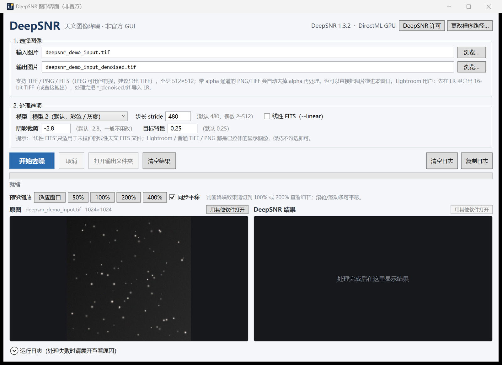

# DeepSNR GUI（非官方 / Unofficial）

[](LICENSE)


给 [StarNet Software](https://starnetastro.com/) 的 **DeepSNR 命令行工具**（`deepsnr.exe`）做的独立 Windows 图形界面。不需要 PixInsight / Photoshop，双击即可用。

> **本仓库只包含 GUI 源代码，不包含 DeepSNR 的可执行文件、模型权重或安装包。**
> 使用前请自行从官方下载并安装 DeepSNR CLI，并接受其许可协议。



## 它是什么 / 不是什么

**是：** 一个以独立进程方式调用官方 `deepsnr.exe` 的 GUI 包装器，提供拖拽、参数设置、进度显示、前后对比预览、批量队列等桌面体验。

**不是：** 不是 DeepSNR 官方项目；不包含、不镜像、不重新分发 DeepSNR 本体；也没有重新实现降噪算法。

## 为什么会有这个项目

DeepSNR 官方目前提供三种使用形式：

| 形式 | 适合谁 |
|---|---|
| PixInsight 模块 | 使用 PixInsight 的用户 |
| Photoshop 插件 | 使用 Photoshop 的用户 |
| 命令行工具（CLI）/ Siril 脚本集成 | 自动化、脚本或其他软件调用 |

没有独立的桌面 GUI。本项目补上这个空白，方便**没有 PixInsight / Photoshop**、但希望用 DeepSNR 的用户（例如 Lightroom 用户）。

DeepSNR 许可（Section 2）明确允许其他应用或脚本**以独立进程方式调用其 CLI** 来自动化图像处理；本项目采用的正是这种方式。

## 功能

- 拖拽或选择 TIFF / PNG / FITS / JPEG 输入
- 自动去除 alpha 通道（4 通道 PNG/TIFF → 3 通道临时 TIFF，处理完自动删除）
- 模型 1 / 2、stride、线性 FITS（`--linear`、阴影裁剪、目标背景）参数
- 实时进度条、完整运行日志（可复制 / 清空 ）、可取消
- 一次拖入多张图片，自动排队处理
- 左右并排预览：适应窗口 / 50% / 100% / 200% / 400%，同步平移
- 自动查找官方安装路径（`D:\DeepSNR` / `C:\Program Files\DeepSNR` / PATH），也可手动指定
- 记住设置；多显示器不同缩放（Per-Monitor V2 DPI）适配
- 输出目录可写预检、权限问题明确提示
- Lightroom 工作流：LR 导出 16-bit TIFF → 拖进本程序 → 结果导回 LR

## 快速开始

1. **安装官方 DeepSNR CLI（必须）**
   从 <https://starnetastro.com/cli-tools/deepsnr/> 下载 Windows 安装包并安装（默认 `D:\DeepSNR` 或 `C:\Program Files\DeepSNR`）。
   安装/使用 DeepSNR 即表示你同意其许可协议（安装包内附 `LICENSE.txt`）。

2. **获取本 GUI**
   - 从 [Releases](../../releases) 下载 `DeepSNR_GUI.exe`（Windows 10/11 自带 .NET Framework 4.8，无需安装运行时）；或
   - 自行编译（见下方“从源码构建”）。

3. **运行**
   把 `DeepSNR_GUI.exe` 放在任意位置，**在 Windows 资源管理器里双击运行**。
   把图片拖进窗口 → 点“开始去噪” → 用 100% / 200% 查看前后对比。

> ⚠️ 请勿从聊天窗口、文件卡片或沙箱环境中启动本程序。那种启动方式权限过低（Low 完整性），只能写工作区，处理桌面图片会报“访问被拒绝”。正常双击运行时程序会自动检测并提示。

## 使用说明

- **输入格式**：TIFF / TIF、PNG、FITS（`.fit/.fits/.fts`，支持 `.gz`）、JPEG（有损，可用但不建议）。DeepSNR 要求图片至少 512×512。
- **输出**：默认 `原文件名_denoised.tif`（FITS 输入为 `.fits`）。位深与输入一致（8-bit 输入输出 8-bit，16-bit 输入输出 16-bit）；TIFF 使用 LZW 压缩。
- **线性 FITS**：只有未拉伸的线性天文 FITS 才勾选“线性 FITS（--linear）”；Lightroom / 普通 TIFF / PNG 都已拉伸，不要勾选。
- **预览**：判断降噪效果请切到 100% 或 200%；勾选“同步平移”时左右两侧一起滚动。
- **批量**：一次拖入多张图片会排队依次处理，输出写在各自原图旁边。
- **FITS 预览**：FITS 无法在界面中预览（无通用解码器），可用 PixInsight / Siril 查看结果。
- **GPU**：官方 Windows 包自带 DirectML，成功时右上角显示“DirectML GPU”，否则自动回退 CPU。

## 从源码构建

需要 Windows 10/11（自带 .NET Framework 4.8 与 C# 编译器，无需安装 Visual Studio）：

```powershell
git clone https://github.com/tianqiQWQ/deepsnr-gui.git
cd deepsnr-gui
powershell -NoProfile -ExecutionPolicy Bypass -File .\build.ps1
# 输出：dist\DeepSNR_GUI.exe
```

也可以把 `src\DeepSNR_GUI.cs`、`src\app.manifest`、`src\deepsnr_gui.ico` 三个文件用任意 C# 编译器编译（见 `build.ps1` 中的 csc 参数）。

## 许可与合规（重要）

本项目采用 **MIT License**（见 [LICENSE](LICENSE)）。以下是使用和分发时必须了解的事项（不构成法律意见）：

- **不包含 DeepSNR 本体。** 本仓库不包含、不镜像、不缓存、不重新分发 DeepSNR 的可执行文件、模型权重、安装包或任何 StarNet 资产。请用户自行从官方渠道下载安装。
- **DeepSNR 是 Mikita (Nikita) Misiura 的产品**，版权归其所有：<https://starnetastro.com/>。本项目与 StarNet Software / Mikita Misiura **没有隶属关系，也未获其背书**。
- **许可允许的集成方式。** DeepSNR 许可 Section 2 允许其他应用/脚本以独立进程方式调用官方 CLI；要求明确标识产品、提供完整许可供查阅，并在使用前取得用户同意。用户通过官方安装器安装时已接受该许可；本 GUI 内也提供“DeepSNR 许可”按钮（打开安装包内 `LICENSE.txt` 或官方页面）。
- **禁止事项。** 不要把 DeepSNR 本体/模型打包进本项目；不要镜像或托管其下载文件；不要用其权重或输出去训练模型，或用于开发、测试、验证其他软件/模型产品；不要绕过其许可限制。如需商业打包分发或额外授权，请先联系 StarNet Software 取得**书面许可**。
- **截图说明。** 本仓库截图使用自行生成的合成测试图，并清空了 DeepSNR 结果预览，不包含 DeepSNR 输出图像。
- **无担保。** 本项目按 MIT “AS IS” 提供，不对处理结果或数据损失承担责任；请保留原始文件备份。

## English summary

An **unofficial** Windows GUI wrapper for StarNet Software's DeepSNR command-line tool. It runs the officially installed `deepsnr.exe` as a separate process; it does **not** bundle, mirror or redistribute DeepSNR, its model files or installers. You must install the official DeepSNR CLI yourself and accept its license. DeepSNR is © Mikita (Nikita) Misiura; this project is not affiliated with or endorsed by StarNet Software. GUI code is MIT-licensed.

## 致谢

- [StarNet Software / DeepSNR](https://starnetastro.com/) by Mikita (Nikita) Misiura
- DeepSNR 的神经网络架构基于 [NAFNet](https://github.com/megvii-research/NAFNet)
- 所有在社区中分享经验与反馈的天文摄影者

## 免责声明

本项目为个人开发的非官方工具，与 StarNet Software 无关。DeepSNR 的安装、许可与使用请以官方说明为准。使用本工具处理图片前请做好备份。
